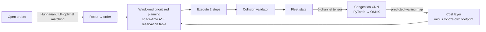

# FleetFlow

**Multi-robot warehouse fleet coordination with a learned congestion forecast.**
Rust planning core (Conflict-Based Search, space-time A*, Hungarian task assignment) compiled to
WebAssembly, a PyTorch congestion model exported to ONNX, and a live side-by-side demo.

**Live demo: https://nags-gk.github.io/fleetflow/**

[](https://github.com/Nags-gk/fleetflow/actions/workflows/ci.yml)

In the demo, two warehouses run the same robots and the same orders on the same floor, one tick at a time.
The left fleet takes the fastest collision-free route. The right fleet also asks a neural
network where robots will be stuck waiting over the next 8 ticks and routes around those cells. At
100 robots the left floor gridlocks; the right one keeps moving.

## Results

All numbers below come from `results/`, are produced by the commands in [Reproduce](#reproduce),
and are the mean of 3 seeds × 1,000 ticks after a 200-tick warm-up on a 40×26 floor with 16 pick
stations. **Every run had zero collisions**, as checked by an independent per-tick validator.

| Robots | Greedy assign | Hungarian assign | + reactive density cost | **+ learned forecast** |
|---:|---:|---:|---:|---:|
| 20  | 564   | 566   | 558   | **566**  |
| 40  | 1,071 | 1,076 | 981   | **1,091** |
| 60  | 1,434 | 1,473 | 1,173 | **1,550** |
| 80  | 1,711 | 1,749 | 1,252 | **1,979** |
| 100 | 804   | 330   | 1,268 | **2,290** |
| 120 | 88    | 123   | 1,309 | **2,337** |

*Orders delivered per 1,000 ticks.*

* **80 robots:** the forecast lifts throughput **13%** over the same planner without it, and cuts mean task time from 38.1 to 33.7 ticks.
* **100–120 robots:** the plain planner gridlocks. The forecast keeps the fleet flowing at **6.9× to 19×** its throughput, and **79–81%** above a reactive density heuristic.
* **Light traffic:** the forecast costs nothing at 20 robots, because it only penalises predicted hotspots above a threshold.

**Congestion forecast accuracy** on held-out simulations (per-cell robot waiting over the next 8 ticks):

| Predictor | Pearson r | MSE | Hotspot recall (top 5%) |
|---|---:|---:|---:|
| Reactive density blur | 0.36 | 0.1255 | 35% |
| scikit-learn HistGradientBoosting, 3×3 patches | 0.87 | 0.0047 | 54% |
| **PyTorch dilated CNN (7,713 params)** | **0.90** | **0.0036** | **54%** |

**One-shot path finding**, with 25 random instances per row on a 24×13 floor:

| Robots | CBS solved | Prioritized solved | Prioritized extra cost | CBS mean time |
|---:|---:|---:|---:|---:|
| 4  | 100% | 100% | 1.6% | 0.1 ms |
| 8  | 100% | 100% | 3.1% | 0.4 ms |
| 12 | 100% | 100% | 6.6% | 3.4 ms |
| 16 | 100% | 100% | 5.4% | 21 ms |

## How it works



| Stage | Implementation | Where |
|---|---|---|
| Floor model | 4-connected grid, shelf pods in 2×5 blocks, 2-wide aisles, stations on both walls; cached BFS distance tables | `core/src/grid.rs` |
| Task allocation | Hungarian algorithm (Kuhn–Munkres, O(n²m)). The assignment LP is totally unimodular, so this is the exact LP optimum. Greedy baseline included. Drop-off station chosen at pickup by distance plus queue length (load balancing). | `core/src/assign.rs`, `sim.rs` |
| Path planning | Space-time A* over (cell, t) with vertex and edge (swap) reservations, a true-distance heuristic and integer costs | `core/src/astar.rs` |
| Lifelong coordination | Rolling-horizon prioritized planning: 10-step window, replans every 2 ticks or whenever a robot finishes a leg. When a robot is boxed in it gets top priority, then random-restart priorities, then a conservative pass that is guaranteed feasible. | `core/src/sim.rs` |
| Optimal MAPF | Conflict-Based Search: best-first constraint tree with ties broken by fewest conflicts, directed edge constraints, and agents resting at goals | `core/src/cbs.rs` |
| Congestion model | Dilated FCN (dilations 1, 2, 4, 8; 31×31 receptive field). Inputs are pods, stations, robots, destinations and an 8-step intent roll-out; the target is per-cell waiting over the next 8 ticks. | `ml/train.py`, `core/src/features.rs` |
| Inference | ONNX Runtime Web in the browser, plus a dependency-free Rust implementation (native benchmarks and WASM fallback). CI checks the two agree to within 1e-4; measured difference is 4.2e-7. | `core/src/cnn.rs`, `web/app.js` |
| Safety | An independent validator counts vertex and swap collisions every tick, and tests assert zero | `sim.rs::count_collisions` |

### Engineering decisions worth noting

* **Predict waiting, not occupancy.** The first model predicted where robots would *be*. Penalising
  that pushed every robot off its own shortest path and cut throughput by 5× or more. Retargeting the
  model to where robots will be *forced to wait*, and subtracting each robot's own footprint before
  it plans, turned the same architecture into a 13–81% gain.
* **Never deadlock the planner.** Windowed prioritized planning is incomplete: a low-priority robot
  can be boxed in. The planner escalates through three remedies: give that robot top priority,
  restart with random priorities, then run a conservative pass in which unplanned robots block their
  own cells. The conservative pass always yields a feasible plan.
* **One feature encoder, three consumers.** The trainer, the native benchmark and the browser all
  call `features::encode`, so train and serve inputs cannot drift apart.
* **Text-diffable model.** The trained weights are committed as JSON, and CI regenerates the ONNX
  file from them before deploying.
* **Deterministic.** A seeded SplitMix64 PRNG gives bit-identical replays natively and in WASM, and a
  test asserts this.

## Repository layout

```
core/      Rust crate: planner, simulator, CNN inference, WASM bindings, `ffsim` CLI
  src/bin/ffsim.rs   bench | mapf | dataset | parity
  tests/             end-to-end test: learned planner vs baseline at 110 robots
ml/        PyTorch / scikit-learn training, ONNX export, pytest suite
model/     trained weights (JSON, canonical)
results/   benchmark + training reports used by the README and the demo
web/       demo page (vanilla JS, Canvas, ONNX Runtime Web)
.github/   CI: fmt, clippy -D warnings, tests, ONNX parity, wasm build, GitHub Pages deploy
```

## Reproduce

```bash
# Rust: 21 tests (unit + end-to-end)
cd core && cargo test --release

# benchmarks (about 10 minutes on 2 cores)
cargo run --release --bin ffsim -- mapf  --instances 25 > ../results/mapf.json
cargo run --release --bin ffsim -- bench --ticks 1000 --seeds 3 --model ../model/congestion.json > ../results/bench_lifelong.json

# training data + model (about 5 minutes on CPU)
cargo run --release --bin ffsim -- dataset --out ../data.bin --samples 3000
cd ../ml && pip install -r requirements.txt && python train.py --data ../data.bin --out ../artifacts
python -m pytest -q test_ml.py

# demo locally
cd ../core && wasm-pack build --release --target web --out-dir ../web/pkg
cd ../ml && python export_onnx.py && cd .. && mkdir -p web/model web/data \
  && cp model/congestion.* web/model/ && cp results/*.json web/data/ && python -m http.server -d web
```

## Limitations

* This is a grid-world simulation: unit-time moves, no kinematics, acceleration or localisation
  error, and no real robots or sensors.
* Prioritized planning is fast but incomplete. The conservative fallback guarantees safety, not
  progress, and the throughput curves show where each method saturates.
* CBS is the basic algorithm plus conflict-count tie-breaking. It is not ICBS or ECBS, so it is
  intended for up to about 16 agents.
* The congestion model was trained on this simulator's layouts and fleet sizes (20–120 robots). It
  has not been tested on other floor plans.

## License

MIT
